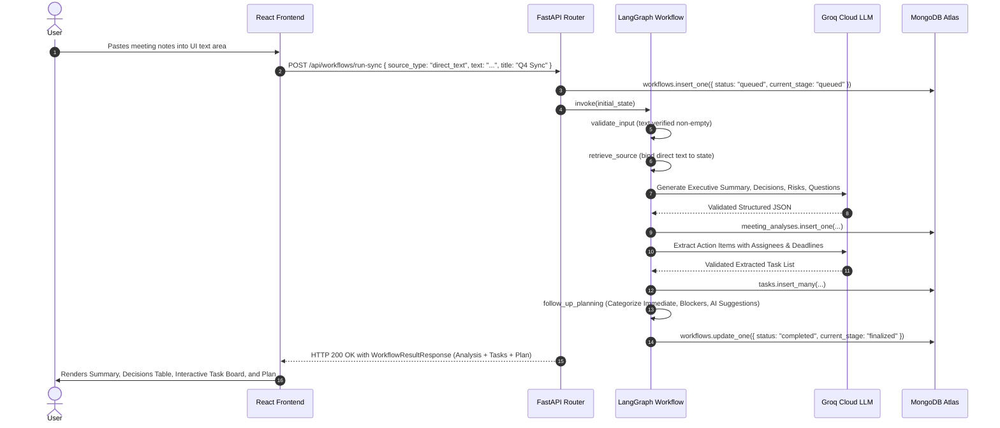
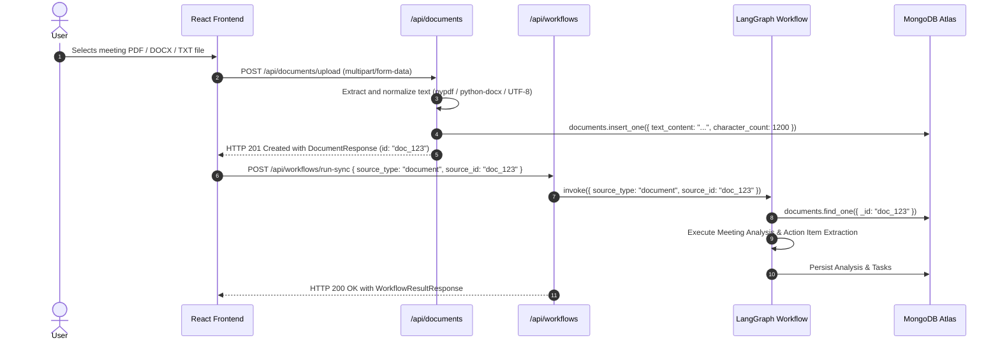
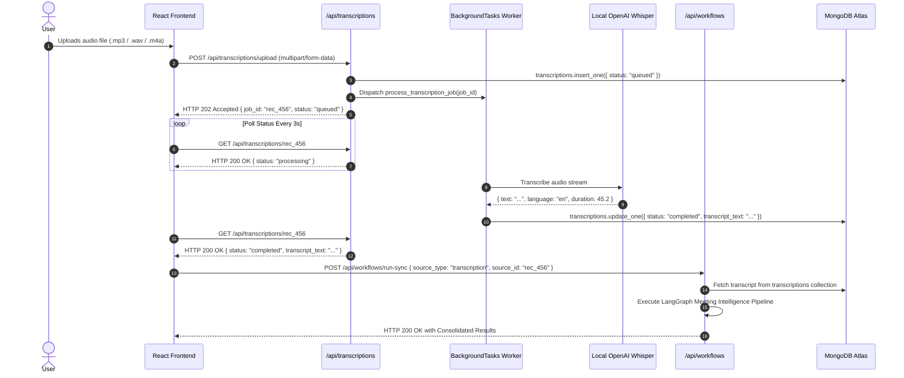
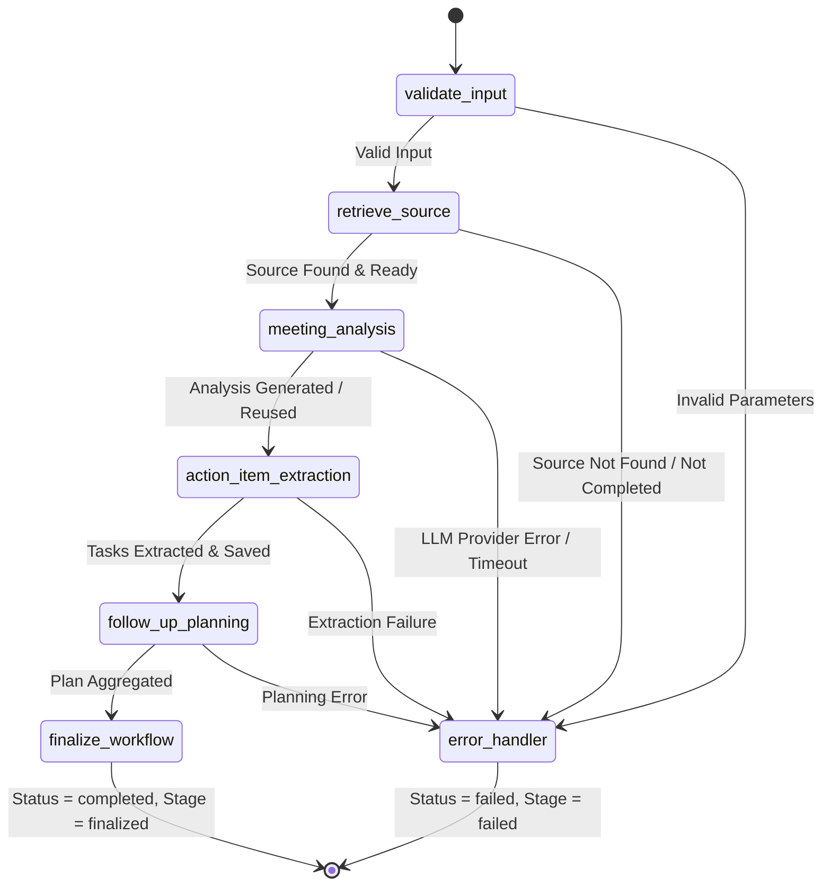

# AI Business Meeting Assistant - Application Workflow & Data Architecture Guide

This guide explains how the backend services, repositories, LangGraph workflow orchestration, Groq Cloud LLM, OpenAI Whisper, and MongoDB Atlas interact across all meeting intelligence scenarios.

---

## 1. System Architecture Diagram

```mermaid
flowchart TD
    subgraph Frontend["React + Vite Client"]
        UI_Audio["Audio Upload UI"]
        UI_Doc["Document / Notes Ingestion"]
        UI_Workflow["Workflow Progress & Poller"]
        UI_Tasks["Interactive Action Items Board"]
        UI_Exports["Multi-Format Export Buttons"]
    end

    subgraph API_Layer["FastAPI Gateway (/api)"]
        R_Trans["/transcriptions"]
        R_Docs["/documents"]
        R_Anal["/analysis"]
        R_Tasks["/tasks"]
        R_Wf["/workflows"]
        R_Health["/health"]
    end

    subgraph Workflow_Engine["LangGraph StateGraph Engine"]
        N_Val["validate_input"]
        N_Ret["retrieve_source"]
        N_Ana["meeting_analysis"]
        N_Task["action_item_extraction"]
        N_Plan["follow_up_planning"]
        N_Fin["finalize_workflow"]
        N_Err["error_handler"]
    end

    subgraph Services["Core Intelligence & File Services"]
        S_Whisper["WhisperService (FFmpeg + Local Whisper)"]
        S_Doc["DocumentExtractionService (PDF/DOCX/TXT)"]
        S_Groq["LLMService / GroqProvider (Qwen/Llama)"]
        S_Task["ActionItemExtractionService"]
        S_Plan["FollowUpPlanningService"]
        S_Exp["TaskExportService (JSON/CSV/MD)"]
    end

    subgraph Database["MongoDB Atlas (AIBusinessMeetingAssistant)"]
        DB_Trans["transcriptions"]
        DB_Docs["documents"]
        DB_Anal["meeting_analyses"]
        DB_Tasks["tasks"]
        DB_Wf["workflows"]
    end

    UI_Audio --> R_Trans
    UI_Doc --> R_Docs
    UI_Workflow --> R_Wf
    UI_Tasks --> R_Tasks
    UI_Exports --> R_Tasks

    R_Trans --> S_Whisper
    R_Trans --> DB_Trans
    R_Docs --> S_Doc
    R_Docs --> DB_Docs

    R_Wf --> Workflow_Engine
    Workflow_Engine --> DB_Wf

    N_Ret --> DB_Trans
    N_Ret --> DB_Docs
    N_Ana --> S_Groq
    N_Ana --> DB_Anal
    N_Task --> S_Task
    N_Task --> DB_Tasks
    N_Plan --> S_Plan
    N_Fin --> DB_Wf
    N_Err --> DB_Wf

    R_Tasks --> S_Exp
    R_Tasks --> DB_Tasks
    R_Anal --> DB_Anal
```



---

## 2. End-to-End Workflow Scenarios

### Scenario 1: Pasted Meeting Notes or Direct Text

Direct meeting notes can be submitted either via the document ingestion endpoint or directly to the LangGraph workflow pipeline.



#### Walkthrough Steps:
1. **Frontend Request**: The user enters notes and clicks "Analyze Meeting". The frontend calls `POST /api/workflows/run-sync` with `source_type="direct_text"`, `text="..."`, and `title="..."`.
2. **Initial Record Creation**: The workflow repository inserts a run record in the `workflows` collection with status `queued`.
3. **Node 1: Input Validation**: Validates that `text` is non-empty.
4. **Node 2: Source Retrieval**: Formats the direct text into `retrieved_text` and records char count in metadata.
5. **Node 3: Meeting Analysis**: Calls Groq Cloud (`qwen/qwen3.8-27b`) with executive analysis prompts. Inserts the resulting structured analysis document into the `meeting_analyses` collection.
6. **Node 4: Action Item Extraction**: Calls Groq Cloud with task extraction prompts. Parses assignees, deadlines, priorities, and evidence excerpts. Saves tasks into the `tasks` collection referencing the created `analysis_id`.
7. **Node 5: Follow-Up Planning**: Deterministically aggregates tasks into categorized groups (`immediate_actions`, `upcoming_tasks`, `clarification_needed`, `blockers_and_dependencies`) and produces actionable AI suggestions.
8. **Node 6: Finalization**: Sets workflow status to `completed` and stage to `finalized` with UTC completion timestamp.
9. **Result Return**: Returns consolidated `WorkflowResultResponse` in a single response payload.

---

### Scenario 2: Document Ingestion (PDF, DOCX, TXT)



#### Walkthrough Steps:
1. **Document Upload**: Frontend uploads `.pdf`, `.docx`, or `.txt` to `POST /api/documents/upload`.
2. **Text Normalization**: `DocumentExtractionService` extracts text and counts words/characters.
3. **Document Persistence**: Stored in `documents` collection with `status="completed"`. The response returns `id: "doc_123"`.
4. **Workflow Execution**: Frontend submits `POST /api/workflows/run-sync` with `source_type="document"` and `source_id="doc_123"`.
5. **Source Retrieval**: LangGraph `retrieve_source` node fetches text from the `documents` collection by ID.
6. **Intelligence Generation**: Meeting analysis and action item extraction proceed identically to Scenario 1.

---

### Scenario 3: Recorded Audio Transcription & Workflow



#### Walkthrough Steps:
1. **Audio Upload**: User uploads recorded audio to `POST /api/transcriptions/upload`.
2. **Background Queue**: Server writes temporary file and creates a `transcriptions` record with status `queued`, returning `202 Accepted`.
3. **Whisper Transcription**: The background worker updates status to `processing`, decodes audio with FFmpeg, runs Whisper inference, and stores the transcript text with status `completed`.
4. **Polling**: Frontend polls `GET /api/transcriptions/{job_id}` until `status === "completed"`.
5. **Workflow Trigger**: Frontend passes `source_type="transcription"` and `source_id=job_id` to `POST /api/workflows/run-sync` (or `POST /api/workflows/start`).
6. **Intelligence Generation**: Meeting analysis, action items, and follow-up plan are generated from the transcribed speech.

---

## 3. Entity & ID Relationship Architecture

```text
┌─────────────────────────┐               ┌─────────────────────────┐
│     transcriptions      │               │        documents        │
│ ─────────────────────── │               │ ─────────────────────── │
│ _id: ObjectId           │               │ _id: ObjectId           │
│ transcript_text: str    │               │ text_content: str       │
└───────────┬─────────────┘               └───────────┬─────────────┘
            │                                         │
            │ (source_id)                             │ (source_id)
            └────────────────────┐   ┌────────────────┘
                                 ▼   ▼
                     ┌─────────────────────────┐
                     │    meeting_analyses     │
                     │ ─────────────────────── │
                     │ _id: ObjectId           │
                     │ source_id: Optional[str]│ ◄── Links to transcriptions or documents
                     │ source_type: str        │     (null for direct_text)
                     │ executive_summary: str  │
                     │ decisions_made: [str]   │
                     └───────────┬─────────────┘
                                 │
                                 │ (analysis_id)
            ┌────────────────────┴────────────────────┐
            ▼                                         ▼
┌─────────────────────────┐               ┌─────────────────────────┐
│          tasks          │               │        workflows        │
│ ─────────────────────── │               │ ─────────────────────── │
│ _id: ObjectId           │               │ _id: ObjectId           │
│ analysis_id: str        │ ◄── Foreign   │ analysis_id: Optional   │
│ description: str        │     Key       │ source_id: Optional     │
│ assignee: Optional[str] │               │ current_stage: str      │
│ status: str             │               │ status: str             │
└─────────────────────────┘               └─────────────────────────┘
```

### Key Relationship Rules:
1. **`source_id` Mapping**:
   - When `source_type="transcription"`, `source_id` is the `_id` of the `transcriptions` record.
   - When `source_type="document"`, `source_id` is the `_id` of the `documents` record.
   - When `source_type="direct_text"`, `source_id` is `null` (raw text is passed in request and stored in the analysis state).
2. **`analysis_id` Foreign Key**:
   - Every action item in the `tasks` collection has a required `analysis_id` field pointing to its parent in `meeting_analyses`.
3. **Deletion Semantics**:
   - **Deleting a Workflow (`DELETE /api/workflows/{id}`)**: Deletes *only* the workflow run tracker. Preserves the underlying meeting analysis and tasks.
   - **Deleting an Analysis (`DELETE /api/analysis/{id}`)**: Deletes the analysis document. Does *not* delete the source transcription or document.
   - **Deleting a Task (`DELETE /api/tasks/{id}`)**: Deletes only that individual task.
   - **Deleting a Document / Transcription**: Deletes only the source record.
4. **Idempotent Regeneration**:
   - When extracting action items with `replace=True` (the default in the workflow pipeline), previously extracted tasks for that `analysis_id` are deleted before new tasks are inserted, preventing duplicate tasks.

---

## 4. LangGraph StateGraph Architecture

The LangGraph pipeline in `backend/app/workflows/meeting_workflow.py` compiles the following directed graph:



### Stage Transitions & Database Timestamps:
Each node calls `_update_workflow_db_stage()` in real time so polling clients immediately observe the active stage:

1. **`queued`**: Initial status upon request submission. `created_at` recorded.
2. **`input_validation`**: Validates `source_type` and required fields. `started_at` recorded.
3. **`source_retrieval`**: Retrieves transcript or document from PyMongo.
4. **`meeting_analysis`**: Generates or reuses structured meeting intelligence. Sets `analysis_id` in database.
5. **`action_item_extraction`**: Extracts and persists grounded tasks.
6. **`follow_up_planning`**: Generates categorized follow-up response and AI recommendations.
7. **`finalized`**: Marks workflow `status="completed"`, `current_stage="finalized"`, `completed_at` timestamp.
8. **`failed`**: If any step fails, conditional edge routes to `error_handler`, recording `error_stage` and `error_message`.
